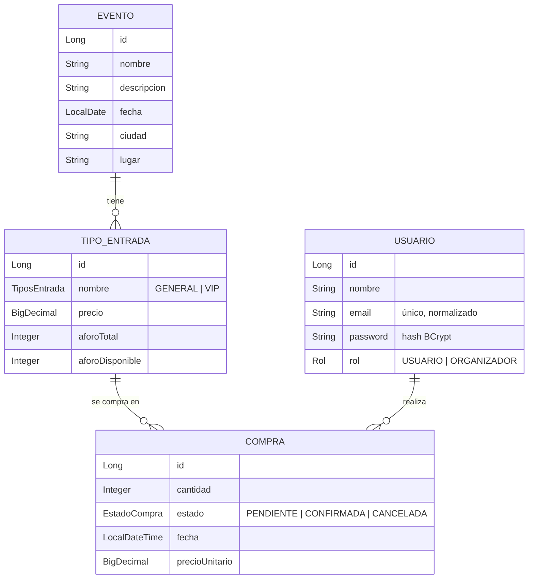

# Event Ticketing Platform (eventos)

API REST para vender entradas de eventos: los organizadores publican eventos con tipos de entrada (GENERAL / VIP) y aforo limitado, y los usuarios reservan, pagan y cancelan sus compras.

Lo más destacable:

- **Concurrencia.** Bloqueo pesimista para que compras y cancelaciones simultáneas nunca vendan más entradas que el aforo ni lo devuelvan dos veces, con tests que lanzan hasta 20 peticiones a la vez. Ver [Concurrencia en las compras](#concurrencia-en-las-compras).
- **Seguridad.** JWT con roles, el comprador sale siempre del token y el login no revela qué emails existen, ni por el mensaje ni por el tiempo de respuesta. Ver [Decisiones de seguridad](#decisiones-de-seguridad).
- **Mensajería.** Kafka publica cada compra confirmada solo tras el commit, con reintentos, *Dead Letter Topic* y protección frente a mensajes envenenados. Ver [Mensajería con Kafka](#mensajería-con-kafka).
- **Tests.** Más de 100 tests, unitarios con Mockito y de integración contra Kafka real con Testcontainers. Los que cubren un fallo concreto se han visto en rojo rompiendo el código que protegen. Ver [Tests](#tests).

## Stack

| Área            | Tecnología                                   |
|-----------------|----------------------------------------------|
| Lenguaje        | Java 25                                      |
| Framework       | Spring Boot 4.1.1 (Web MVC, Data JPA, Security, Validation, Actuator) |
| Build           | Gradle (wrapper incluido)                    |
| Documentación API | springdoc-openapi 3.1.0 (Swagger UI)       |
| Base de datos   | H2 en memoria (local) · PostgreSQL 17 (Docker) |
| Mensajería      | Apache Kafka 4.0.1 (Docker)                  |
| Tests           | JUnit 5, Mockito, Testcontainers (Kafka)     |
| Otros           | Lombok                                       |

## Funcionalidades

| Funcionalidad | Detalle |
|---|---|
| CRUD de eventos con tipos de entrada | Filtros opcionales por `ciudad` (sin distinguir mayúsculas) y `fecha` |
| Reglas de negocio de los eventos | No se puede reducir el aforo por debajo de lo vendido, ni repetir tipos, ni eliminar un evento o un tipo de entrada que tenga compras (aunque estén canceladas) |
| Compra de entradas | `POST /compras` con control de aforo y bloqueo pesimista frente a compras concurrentes |
| Estados de compra | Reserva `PENDIENTE`, pago simulado (`CONFIRMADA`) y cancelación (`CANCELADA`) que devuelve el aforo |
| Listado de compras | `GET /compras` paginado con las compras del usuario del token |
| Usuarios | Registro y login; organizador inicial creado al arrancar desde variables de entorno |
| Seguridad | JWT (HS256) con roles `USUARIO` / `ORGANIZADOR`; el comprador sale del token |
| Kafka | Evento `CompraConfirmada` publicado tras el commit; un consumer simula el email de confirmación (con reintentos y DLT) |
| Errores | Formato estándar `ProblemDetail` (RFC 9457) en todas las respuestas de error |

## Arranque rápido

### Local (H2 en memoria)

```bash
./gradlew bootRun        # Linux / macOS
gradlew.bat bootRun      # Windows
```

La aplicación arranca en `http://localhost:8080`. Por defecto Kafka apunta a `localhost:29092` (configurable con `SPRING_KAFKA_BOOTSTRAP_SERVERS`), que es el puerto externo del broker de `docker-compose`. Levántalo antes de arrancar:

```bash
JWT_SECRET=local docker compose up -d kafka
```

`docker compose` exige `JWT_SECRET` aunque solo arranques Kafka; aquí basta cualquier valor porque la aplicación no corre en Docker. Sin broker la aplicación arranca, pero no puede publicar ni consumir mensajes.

`./gradlew bootRun` y `./gradlew test` usan un `JWT_SECRET` de desarrollo definido en `build.gradle` (solo para esas dos tareas; no se incluye en el jar). Si tienes la variable `JWT_SECRET` definida, se usa la tuya. Para poder crear eventos hace falta un organizador; defínelo antes de arrancar (ver [Organizador inicial](#organizador-inicial)):

```bash
ORGANIZADOR_EMAIL=org@example.com ORGANIZADOR_PASSWORD=cambia-esto ./gradlew bootRun
```

### Docker (app + PostgreSQL + Kafka)

```bash
cp .env.example .env
# Edita .env: JWT_SECRET es obligatorio (genera uno con: openssl rand -base64 32)
docker compose up --build
```

Sin `JWT_SECRET`, `docker compose` se niega a arrancar. Si tienes un volumen de PostgreSQL de una versión anterior (sin las columnas `password` y `rol` de usuarios), recréalo con `docker compose down -v`; se pierden los datos de desarrollo.

Variables disponibles en `.env`:

| Variable | Por defecto | Descripción |
|---|---|---|
| `APP_PORT` | `8080` | Puerto expuesto de la aplicación |
| `POSTGRES_PORT` | `5432` | Puerto expuesto de PostgreSQL |
| `POSTGRES_DB` | `eventos` | Nombre de la base de datos |
| `POSTGRES_USER` | `eventos` | Usuario de PostgreSQL |
| `POSTGRES_PASSWORD` | `eventos` | Contraseña de PostgreSQL |
| `SPRING_JPA_HIBERNATE_DDL_AUTO` | `update` | Estrategia de esquema de Hibernate |
| `KAFKA_PORT` | `29092` | Puerto externo de Kafka |
| `JWT_SECRET` | — (obligatoria) | Clave para firmar los tokens, en Base64 y de al menos 32 bytes |
| `ORGANIZADOR_EMAIL` | vacía | Email del organizador inicial (opcional) |
| `ORGANIZADOR_PASSWORD` | vacía | Password del organizador inicial (opcional) |
| `ORGANIZADOR_NOMBRE` | `Organizador` | Nombre del organizador inicial |

## Autenticación

La API usa JWT. El flujo es:

1. **Registro** (`POST /auth/registro`): crea un usuario con rol `USUARIO`.
2. **Login** (`POST /auth/login`): devuelve un token firmado que caduca en 1 hora.
3. **Peticiones protegidas**: envía el token en la cabecera `Authorization: Bearer <token>`.

Registro:

```json
{ "nombre": "Ana", "email": "ana@example.com", "password": "secreto123" }
```

Respuesta (`201`):

```json
{ "id": 2, "nombre": "Ana", "email": "ana@example.com", "rol": "USUARIO" }
```

Login:

```json
{ "email": "ana@example.com", "password": "secreto123" }
```

Respuesta (`200`):

```json
{ "token": "eyJhbGciOiJIUzI1NiJ9...", "tipo": "Bearer", "expiraEnSegundos": 3600 }
```

El token lleva el id del usuario (`sub`) y su rol (`roles`).

### Permisos

| Endpoint | Anónimo | `USUARIO` | `ORGANIZADOR` |
|---|---|---|---|
| `POST /auth/registro`, `POST /auth/login` | ✅ | ✅ | ✅ |
| `GET /eventos`, `GET /eventos/{id}` | ✅ | ✅ | ✅ |
| `POST /eventos`, `PUT /eventos/{id}`, `DELETE /eventos/{id}` | `401` | `403` | ✅ |
| `POST /compras`, `POST /compras/{id}/pagar`, `POST /compras/{id}/cancelar`, `GET /compras` | `401` | ✅ (solo las suyas) | ✅ (solo las suyas) |
| Swagger, `/actuator/health`, `/actuator/info` | ✅ | ✅ | ✅ |

### Organizador inicial

El registro siempre crea usuarios `USUARIO`, para que nadie pueda asignarse un rol. El primer `ORGANIZADOR` se crea al arrancar si están definidas `ORGANIZADOR_EMAIL` y `ORGANIZADOR_PASSWORD`:

- Sin esas variables no se crea nada; no hay credenciales por defecto en el código.
- Si el email ya existe, no se modifica (ni password ni rol), así que reiniciar es seguro.
- Un password inválido (menos de 8 caracteres o más de 72 bytes) impide arrancar la aplicación.

### Decisiones de seguridad

- Los passwords se guardan con BCrypt. Como BCrypt solo admite 72 bytes, el máximo se valida en bytes y no en caracteres.
- El email se normaliza (minúsculas, sin espacios) al registrar y al hacer login.
- Email inexistente y password incorrecto devuelven el mismo `401` con el mismo mensaje, para no revelar qué emails están registrados.
- Por el mismo motivo, **tardan lo mismo**. Antes, con un email inexistente el login respondía sin ejecutar BCrypt (unos 0,1 ms frente a unos 50 ms con un password incorrecto), y midiendo el tiempo se podía saber si un email existía aunque el body fuera idéntico (*ataque de timing*). Ahora siempre se ejecuta BCrypt: si el email no existe, contra un hash ficticio calculado al arrancar con el mismo encoder. `LoginTiempoDeRespuestaTest` mide los dos casos con BCrypt real.
- El usuario de una compra sale del token (`sub`), nunca del body: nadie puede comprar en nombre de otro.
- `JWT_SECRET` no tiene valor por defecto: si falta, la aplicación no arranca. Con una clave por defecto en el repositorio, quien arrancara el jar sin configurarla firmaría los tokens con una clave pública y cualquiera podría fabricarse un token de `ORGANIZADOR`.
- La API no guarda sesión (`STATELESS`): cada petición se valida solo con su token.

## API

- Swagger UI: http://localhost:8080/swagger-ui.html. Para los endpoints con candado, haz login en `/auth/login`, pulsa **Authorize** y pega el token (sin el prefijo `Bearer`).
- OpenAPI: http://localhost:8080/v3/api-docs
- Health: http://localhost:8080/actuator/health

### Eventos

| Método | Ruta | Descripción | Respuesta |
|---|---|---|---|
| `GET` | `/eventos` | Lista eventos. Filtros opcionales: `ciudad`, `fecha` (`YYYY-MM-DD`) | `200` |
| `GET` | `/eventos/{id}` | Obtiene un evento con sus tipos de entrada | `200` / `404` |
| `POST` | `/eventos` | Crea un evento (`ORGANIZADOR`) | `201` / `400` / `401` / `403` |
| `PUT` | `/eventos/{id}` | Reemplaza los datos de un evento (`ORGANIZADOR`) | `200` / `400` / `401` / `403` / `404` / `409` |
| `DELETE` | `/eventos/{id}` | Elimina un evento sin compras (`ORGANIZADOR`) | `204` / `401` / `403` / `404` / `409` |

Ejemplo de petición (`POST /eventos`):

```json
{
  "nombre": "Concierto de verano",
  "descripcion": "Festival al aire libre",
  "fecha": "2026-12-01",
  "ciudad": "Madrid",
  "lugar": "Estadio Central",
  "tipoEntrada": [
    { "nombre": "GENERAL", "precio": 35.00, "aforoTotal": 500 },
    { "nombre": "VIP", "precio": 90.00, "aforoTotal": 50 }
  ]
}
```

Ejemplo de filtro:

```
GET /eventos?ciudad=Madrid&fecha=2026-12-01
```

### Compras

Requiere token (cualquier rol). La compra se hace a nombre del usuario del token; el body no indica el usuario. Cada usuario solo ve, paga y cancela sus propias compras.

| Método | Ruta | Descripción | Respuesta |
|---|---|---|---|
| `POST` | `/compras` | Reserva entradas de un tipo (`PENDIENTE`) y descuenta el aforo | `201` / `400` / `401` / `404` / `409` |
| `POST` | `/compras/{id}/pagar` | Pago simulado: pasa la compra a `CONFIRMADA` | `200` / `401` / `404` / `409` |
| `POST` | `/compras/{id}/cancelar` | Cancela la compra y devuelve el aforo | `200` / `401` / `404` / `409` |
| `GET` | `/compras` | Mis compras, paginadas (`page`, `size`), de la más reciente a la más antigua | `200` / `401` |

Ejemplo de petición:

```json
{ "tipoEntradaId": 1, "cantidad": 3 }
```

Ejemplo de respuesta (`201`):

```json
{
  "id": 1,
  "usuarioId": 1,
  "eventoId": 1,
  "tipoEntradaId": 1,
  "tipoEntrada": "GENERAL",
  "cantidad": 3,
  "precioUnitario": 35.00,
  "total": 105.00,
  "estado": "PENDIENTE",
  "fecha": "2026-10-13T12:00:00"
}
```

El precio unitario se copia del tipo de entrada en el momento de la compra, así que un cambio de precio posterior no altera las compras existentes.

#### Estados de una compra

```
POST /compras ──► PENDIENTE ──pagar──► CONFIRMADA
                      │                    │
                      └──cancelar──► CANCELADA ◄──cancelar (devolución)
```

| Estado actual | `pagar` | `cancelar` |
|---|---|---|
| `PENDIENTE` | → `CONFIRMADA` | → `CANCELADA` |
| `CONFIRMADA` | `409` | → `CANCELADA` |
| `CANCELADA` | `409` | `409` |

- **La reserva ya descuenta el aforo.** Así nadie puede quedarse sin entrada mientras paga. Al cancelar se devuelve.
- **Las transiciones viven en la entidad** (`Compra.pagar()` y `Compra.cancelar()`), que no expone `setEstado`. Ningún servicio puede saltarse las reglas.
- **La compra de otro usuario devuelve `404`, no `403`**, para no revelar que existe. El filtro por usuario va en la propia consulta.
- **El mensaje de Kafka sale al pagar**, no al reservar: una reserva sin pagar no es una compra confirmada.

#### Concurrencia al cancelar

Si varias peticiones cancelan a la vez la misma compra, todas leerían el estado sin cancelar y cada una devolvería el aforo, con lo que el tipo de entrada acabaría con más plazas de las que tiene. Por eso `cancelar` lee la compra con `SELECT ... FOR UPDATE` (`CompraRepository.findByIdAndUsuarioIdForUpdate`): la segunda petición espera, ve `CANCELADA` y recibe un `409`. Después bloquea el tipo de entrada para devolver el aforo, igual que al comprar.

Los bloqueos se toman siempre en el mismo orden (primero la compra y después el tipo de entrada); `comprar` solo bloquea el tipo, así que no hay ciclos ni *deadlocks*. `CompraEstadosServiceIntegrationTests.cancelacionesConcurrentesSoloDevuelvenElAforoUnaVez` lanza 10 cancelaciones simultáneas de la misma compra y comprueba que solo una tiene éxito y que el aforo se devuelve una sola vez.

#### Listado paginado

Ejemplo (`GET /compras?page=0&size=2`):

```json
{
  "content": [ { "id": 3, "estado": "CONFIRMADA", "...": "..." }, { "id": 2, "estado": "PENDIENTE", "...": "..." } ],
  "page": { "size": 2, "number": 0, "totalElements": 3, "totalPages": 2 }
}
```

- Tamaño por defecto 20 y máximo 100: un `size` mayor se limita a 100.
- **El orden lo fija el servidor** (fecha descendente y, a igual fecha, id). Se ignora el parámetro `sort`: con un orden libre se podría ordenar por campos que no se devuelven (por ejemplo `usuario.password`) e inferir su valor por la posición.
- **Sin N+1.** La respuesta incluye el tipo de entrada de cada compra; un `@EntityGraph` lo trae en la misma consulta en vez de lanzar una consulta extra por compra. `CompraListadoConsultasIntegrationTests` cuenta las consultas SQL con las estadísticas de Hibernate.
- La respuesta usa `PagedModel` (formato estable de Spring Data) en lugar de serializar `Page` directamente.

### Errores

Los errores siguen el formato estándar `ProblemDetail` ([RFC 9457](https://www.rfc-editor.org/rfc/rfc9457)), con `Content-Type: application/problem+json`:

```json
{
  "type": "about:blank",
  "title": "Conflict",
  "status": 409,
  "detail": "Aforo insuficiente: se solicitaron 11 entradas y solo quedan 10",
  "instance": "/compras"
}
```

Los errores de validación añaden la lista `errores`, con un elemento por cada campo no válido:

```json
{
  "type": "about:blank",
  "title": "Bad Request",
  "status": 400,
  "detail": "La petición tiene campos no válidos",
  "instance": "/compras",
  "errores": [
    { "campo": "cantidad", "mensaje": "La cantidad debe ser mayor que 0" }
  ]
}
```

Los servicios lanzan excepciones propias (`AforoInsuficienteException`, `EventoNotFoundException`…) que no saben nada de HTTP; `GlobalExceptionHandler` decide el código de cada una. Al extender `ResponseEntityExceptionHandler`, los errores del propio Spring MVC (JSON mal formado, método no permitido, etc.) salen con el mismo formato.

Los `401` y `403` que genera Spring Security (sin token, token inválido o sin el rol necesario) se producen antes de llegar a los controladores: van con el body vacío y la cabecera `WWW-Authenticate`, como define el estándar de tokens Bearer (RFC 6750). El `401` de credenciales incorrectas en el login sí es un `ProblemDetail`, y es idéntico tanto si el email no existe como si el password es incorrecto.

| Código | Cuándo |
|---|---|
| `400` | Validación fallida, JSON mal formado o tipo de entrada repetido |
| `401` | Sin token, token inválido o caducado, o email/password incorrectos en el login |
| `403` | Token válido pero sin el rol necesario (p. ej. un `USUARIO` creando eventos) |
| `404` | Evento, usuario o tipo de entrada no encontrado |
| `409` | Aforo insuficiente, email ya registrado, transición de estado no válida, edición que entra en conflicto con entradas ya vendidas, o borrado de un evento o tipo de entrada con compras |

## Modelo de dominio



## Concurrencia en las compras

**Problema.** La versión inicial de `CompraService.comprar` leía el aforo disponible, comprobaba que había suficiente y lo descontaba. Con varias compras simultáneas del mismo tipo de entrada, todas leían el mismo aforo antes de que ninguna confirmara, todas pasaban la comprobación y cada una sobrescribía el valor de la anterior (*lost update*). Resultado: se vendían más entradas que el aforo y el aforo disponible no cuadraba con las compras guardadas.

**Cómo se demuestra.** `CompraServiceIntegrationTests.comprasConcurrentesNoVendenMasQueElAforo` lanza 20 compras de 1 entrada a la vez (sincronizadas con un `CountDownLatch`) sobre un tipo con aforo 10, y comprueba que:

- exactamente 10 compras tienen éxito y 10 se rechazan con `AforoInsuficienteException` (`409`);
- el aforo disponible queda en 0 y hay 10 compras guardadas;
- se cumple el invariante `aforo disponible + entradas compradas = aforo total`.

Con la versión inicial el test falla; con el bloqueo pasa.

**Solución.** El tipo de entrada se lee con bloqueo pesimista (`@Lock(LockModeType.PESSIMISTIC_WRITE)` en `TipoEntradaRepository.findByIdForUpdate`, que genera un `SELECT ... FOR UPDATE`). Las compras del mismo tipo de entrada esperan su turno en la base de datos y cada una ve el aforo ya descontado por la anterior. Se eligió el bloqueo pesimista en lugar del optimista (`@Version`) porque la venta de entradas tiene mucha contención sobre la misma fila: con el optimista, la mayoría de compras fallarían y habría que reintentarlas.

**Editar y borrar eventos.** Editar un evento recalcula el aforo disponible de cada tipo de entrada a partir de lo vendido. Si leyera los tipos sin bloquearlos, una compra podría confirmarse entre la lectura y la escritura, y la edición sobrescribiría el aforo con el valor anterior: esa venta se perdería y se podrían vender más entradas que el aforo. Por eso editar y borrar bloquean antes todos los tipos de entrada del evento (`TipoEntradaRepository.findByEventoIdForUpdate`, en orden de id para que dos ediciones no se bloqueen mutuamente). Las compras de ese evento esperan a que termine la edición, y dos ediciones del mismo evento se ejecutan una detrás de otra. `EventoConComprasIntegrationTests.editarElEventoMientrasSeCompraNoPierdeNingunaVenta` lanza 40 compras y 20 ediciones a la vez y comprueba que no se pierde ninguna venta.

Un evento o un tipo de entrada con compras, aunque estén canceladas, no se puede borrar (`409`): las compras son un registro histórico y apuntan a su tipo de entrada.

## Mensajería con Kafka

Cada compra confirmada (al pagarla) publica un mensaje en Kafka. Un consumer lo lee y simula el envío del email de confirmación (de momento, una línea de log). El consumer vive en la misma aplicación, pero solo conoce el mensaje, así que podría moverse a otro servicio sin tocar el código de compras.

```
POST /compras/{id}/pagar
  └─ CompraService.pagar()  (@Transactional)
       ├─ Compra.pagar(): PENDIENTE → CONFIRMADA
       └─ publishEvent(CompraConfirmadaEvent)        ← evento interno de Spring
     COMMIT
       └─ CompraConfirmadaPublisher  (@TransactionalEventListener AFTER_COMMIT)
            └─ kafkaTemplate.send("compras.confirmadas", compraId, evento)
                  └─ NotificacionConsumer  (@KafkaListener, grupo "notificaciones")
                        └─ NotificacionService.enviarConfirmacion()
```

| Topic | Particiones | Uso |
|---|---|---|
| `compras.confirmadas` | 3 | Una entrada por compra confirmada; la clave es el `compraId` |
| `compras.confirmadas-dlt` | 3 | Mensajes que el consumer no ha podido procesar (*Dead Letter Topic*) |

Ejemplo de mensaje:

```json
{
  "compraId": 1,
  "usuarioId": 2,
  "email": "ana@example.com",
  "nombreEvento": "Concierto de verano",
  "tipoEntrada": "GENERAL",
  "cantidad": 2,
  "total": 70.00,
  "fechaCompra": "2026-10-18T14:57:38"
}
```

### Decisiones

- **Se publica después del commit.** Si el mensaje se enviara dentro de la transacción y luego hubiera un rollback, se mandaría el email de una compra que no existe. `@TransactionalEventListener(phase = AFTER_COMMIT)` solo se ejecuta si la transacción termina bien.
- **El `compraId` es la clave.** Kafka solo garantiza el orden dentro de una partición, y la clave decide la partición. Así, todos los mensajes de una misma compra (por ejemplo, confirmada y después cancelada) se leen en orden.
- **El mensaje es un record propio (`CompraConfirmadaEvent`), no la entidad.** Solo lleva tipos simples, así que un cambio en el modelo JPA no rompe los mensajes que ya están en el topic. Por el mismo motivo, el consumer no usa la cabecera `__TypeId__` (que lleva el nombre de la clase Java del productor): el tipo destino se fija en la configuración.
- **Reintentos limitados y DLT.** Si el consumer falla, se reintenta 2 veces con 1 s de espera (`DefaultErrorHandler` + `FixedBackOff`) y después el mensaje pasa a `compras.confirmadas-dlt`, con cabeceras que explican el error. No se reintenta indefinidamente porque, mientras tanto, la partición queda bloqueada.
- **Mensajes envenenados.** Un mensaje que ni siquiera se puede deserializar (*poison pill*) bloquearía la partición para siempre. `ErrorHandlingDeserializer` captura el error y el mensaje va directo a la DLT, sin reintentos.
- **La DLT tiene las mismas particiones que el topic original**, porque el mensaje fallido se publica en la misma partición de la que vino.
- **`auto-offset-reset=earliest`.** Un grupo de consumers nuevo empieza por el principio del topic en vez de ignorar los mensajes ya publicados.

### Limitaciones conocidas

- **Doble escritura (*dual write*).** La compra se guarda en la base de datos y el mensaje se envía a Kafka por separado. Si Kafka no está disponible justo después del commit, la compra queda guardada pero el mensaje se pierde; solo queda un `log.error`. La solución habitual es el patrón *outbox* (ver [Posibles mejoras](#posibles-mejoras)).
- **Entrega *at-least-once*.** Si el consumer se cae después de procesar un mensaje y antes de confirmar el offset, lo vuelve a leer: el mismo email podría enviarse dos veces. El consumer no es idempotente.
- **Valor en la DLT.** Cuando el error es de deserialización, el valor original se guarda en la DLT como un string base64 en lugar de los bytes tal cual, porque se publica con el serializador JSON. Se puede recuperar, pero no reenviar directamente.

### Ver los mensajes

Con el broker de `docker-compose` levantado:

```bash
# Mensajes de compras confirmadas (con clave y partición)
docker exec -it eventos-kafka /opt/kafka/bin/kafka-console-consumer.sh --bootstrap-server localhost:9092 \
  --topic compras.confirmadas --from-beginning --property print.key=true --property print.partition=true

# Mensajes fallidos (con las cabeceras del error)
docker exec -it eventos-kafka /opt/kafka/bin/kafka-console-consumer.sh --bootstrap-server localhost:9092 \
  --topic compras.confirmadas-dlt --from-beginning --property print.headers=true
```

Las cabeceras `kafka_dlt-original-partition`, `-offset` y `-timestamp` se guardan en binario, así que la consola las muestra con caracteres extraños.

## Estructura del proyecto

```
src/main/java/com/jnrptt/eventos/
├── config/       # Seguridad (JWT), OpenAPI, topics de Kafka y organizador inicial
├── controller/   # Controladores REST
├── dto/          # Objetos de petición y respuesta
├── event/        # Mensaje de Kafka, publisher (tras el commit) y consumer
├── exception/    # Excepciones propias y manejador global
├── model/        # Entidades JPA y enums
├── repository/   # Repositorios Spring Data y Specifications
├── service/      # Lógica de negocio, generación de tokens y notificaciones
└── validation/   # Validaciones propias (política de password)
```

## Tests

```bash
./gradlew test
```

Hay dos tipos de tests:

| Tipo | Clases | Qué prueban | Necesitan |
|---|---|---|---|
| Unitarios | `CompraTest`, `CompraServiceTest`, `UsuarioServiceTest`, `LoginTiempoDeRespuestaTest` | La lógica aislada: transiciones de estado, qué se guarda, qué se publica, el orden de los bloqueos. Las dependencias son mocks de Mockito | Nada (tardan menos de 1 s) |
| Integración | `*IntegrationTests` | La aplicación completa con base de datos y Kafka reales: HTTP, seguridad, concurrencia, mensajería | Docker |

Los unitarios no sustituyen a los de integración: con mocks no se puede comprobar que un `SELECT ... FOR UPDATE` bloquee de verdad ni que un mensaje llegue al consumer. Sirven para lo que no depende de la infraestructura, por ejemplo que una cancelación repetida se rechace antes de bloquear el tipo de entrada (`CompraServiceTest` lo verifica con `verify(..., never())`).

Solo los unitarios:

```bash
./gradlew test --tests "*Test"
```

Los tests de integración usan `@SpringBootTest` sobre H2 en memoria. Kafka se levanta con [Testcontainers](https://testcontainers.com/) (misma imagen `apache/kafka:4.0.1` que en `docker-compose`), así que **los tests necesitan Docker en marcha**. Spring Boot configura la conexión al contenedor con `@ServiceConnection`; no hace falta tener el broker de `docker-compose` levantado.

`CompraKafkaIntegrationTests` comprueba el flujo completo contra el broker real:

- una compra pagada llega al consumer con sus datos;
- una reserva sin pagar no publica nada;
- una compra rechazada por aforo no publica nada;
- un evento publicado dentro de una transacción que hace rollback no llega a enviarse. Con `@EventListener` en lugar de `@TransactionalEventListener(AFTER_COMMIT)`, este test falla.

## Posibles mejoras

Fuera del alcance actual.

**Dominio y API**

- **Caducidad de las reservas.** Una compra `PENDIENTE` retiene aforo indefinidamente. Un proceso periódico (`@Scheduled`) podría cancelar las reservas sin pagar tras unos minutos y devolver el aforo.
- **Eventos con dueño.** Ahora cualquier `ORGANIZADOR` puede editar o borrar cualquier evento. Guardar el organizador en el evento (`Evento.organizador`) permitiría limitar cada uno a los suyos.
- **Nombre del campo de tipos de entrada.** La petición de eventos usa `tipoEntrada` y la respuesta `tiposEntrada`. Unificarlo es un cambio incompatible de la API, así que habría que versionarla o hacerlo antes de tener clientes.

**Mensajería**

- **Patrón *outbox*.** Guardar el mensaje en una tabla dentro de la misma transacción que la compra y publicarlo desde ahí (con un proceso periódico o con CDC, por ejemplo Debezium). Elimina la pérdida de mensajes si Kafka cae justo después del commit.
- **Consumer idempotente.** Guardar los `compraId` ya procesados y descartar los repetidos, para que una relectura no envíe el email dos veces.
- **Eventos de cancelación.** Publicar también las cancelaciones en Kafka (por ejemplo, para un email de devolución). Requiere distinguir tipos de mensaje en un mismo topic, para mantener el orden por `compraId`, o aceptar un topic aparte sin orden garantizado entre ambos.
- **`@RetryableTopic`.** Reintentos en topics aparte con espera creciente, sin bloquear la partición mientras se reintenta.
- **DLT con los bytes originales.** Publicar los mensajes no deserializables con un `ByteArraySerializer` para poder reenviarlos tal cual.

**Otras**

- **Caché con Redis** para el listado de eventos, que se lee mucho más de lo que se modifica.
- **Aforo en tiempo real con WebSocket**, para que los clientes vean cómo bajan las entradas disponibles sin recargar.
- **Panel de estadísticas** para organizadores: ventas por evento y por tipo de entrada.
